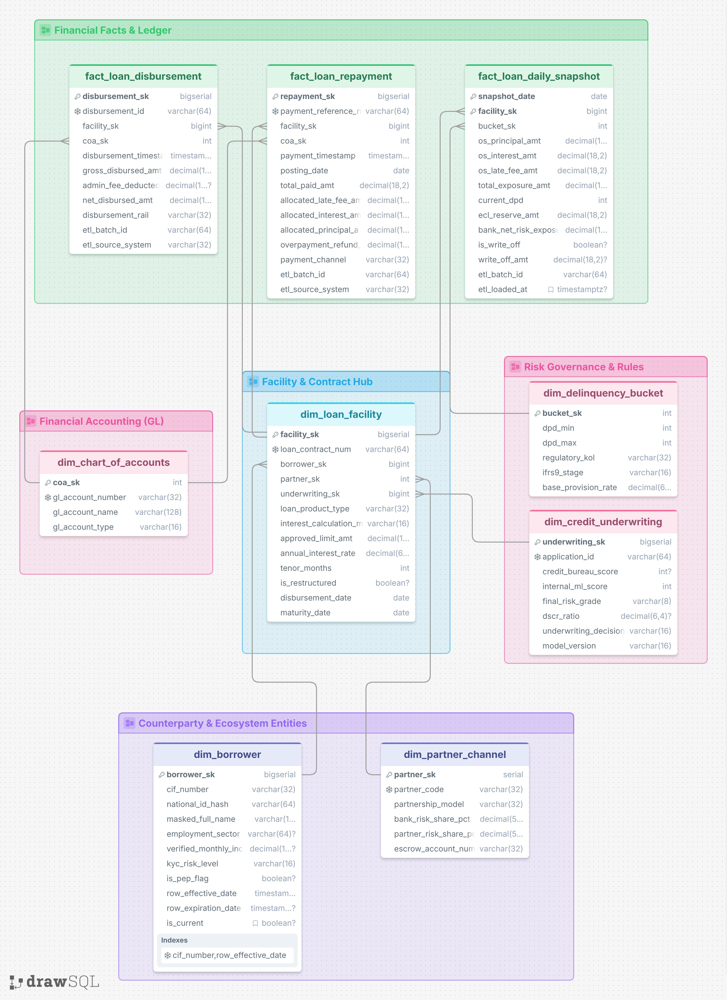

# ssot-data-architecture-banking
# Enterprise Data Architecture for Digital Lending: Single Source of Truth (SSOT)

A production-grade Data Warehouse implementation modeling an end-to-end digital lending ecosystem. Built with a **Snowflake Dimensional Schema** on PostgreSQL, this project establishes a Single Source of Truth (SSOT) to eliminate reconciliation discrepancies between transactional ledgers, risk underwriting, and regulatory reporting (IFRS 9 / PSAK 71).

---

## 🏛️ Architecture Overview

The warehouse decouples high-frequency transactional mutations from daily risk position snapshots through a central facility anchor.



### Domain Segregation
* **Central Facility Hub (`dim_loan_facility`):** Serves as the central entity linking counterparties, underwriting scores, and facility terms.
* **Financial Accounting / General Ledger:** Connects disbursement and repayment cash events directly to standard Chart of Accounts (CoA).
* **Credit Risk & Delinquency Governance:** Houses regulatory Days Past Due (DPD) buckets, PSAK 71/IFRS 9 impairment stages, and underwriting decisions.
* **Counterparty Entities:** Stores borrower and channel partner attributes. Includes SCD Type 2 tracking and SHA-256 ID hashing for personal data protection compliance (UU PDP).

---

## 📂 Repository Structure

```text
ssot-data-architecture-banking/
├── assets/
│   ├── erd_snowflake_architecture.png
│   └── dbeaver_risk_mart_execution.png
├── src/
│   ├── 01_ddl_digital_bank_ssot.sql
│   ├── 02_seed_mock_portfolio_data.sql
│   └── 03_risk_mart_analytics_query.sql
└── README.md

⚙️ Data Warehouse Layering
stg (Staging Layer): Landing area for raw partner feeds and payload isolation (quarantine_bad_records).

dwh (Core Warehouse): Enterprise Snowflake Dimensional Model enforcing relational constraints, foreign keys, and audit metadata.

dm (Data Mart): Analytical serving views powering Credit Risk dashboards and executive aggregations.

📊 Proof of Work: Risk Mart Analytics
Execution of dm.vw_daily_portfolio_risk_summary aggregating portfolio exposure and ECL provisions across 25 accounts:

🚀 Reproduction Steps
Execute the SQL scripts in order using any PostgreSQL client (e.g., DBeaver, psql):

Deploy Schemas & DDL: Run src/01_ddl_digital_bank_ssot.sql

Seed Production Mock Data: Run src/02_seed_mock_portfolio_data.sql

Run Analytics Queries: Run src/03_risk_mart_analytics_query.sql
